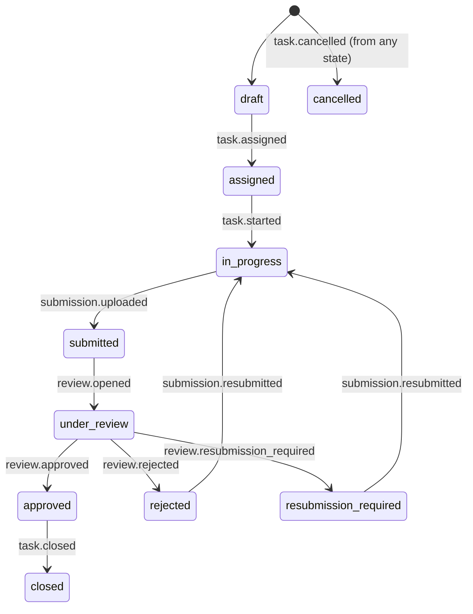
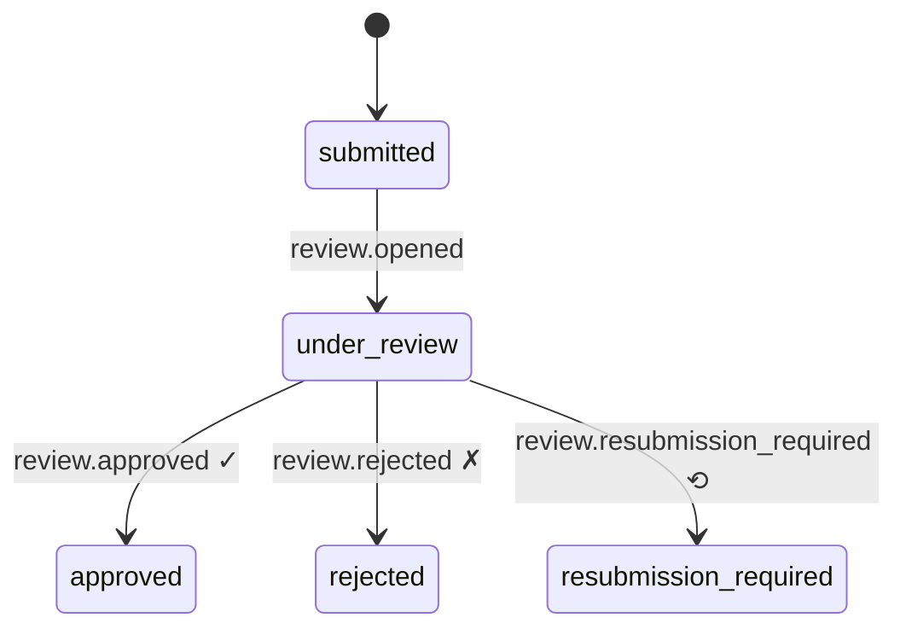
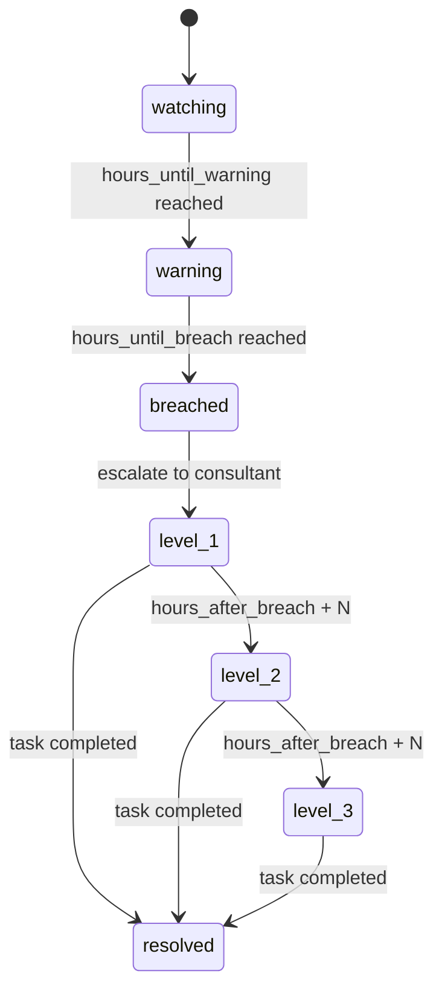

# Backend Architecture Specification
**Digital Evidence & Compliance Management Platform** | **منصة إدارة الأدلة والامتثال الرقمي**

Version 1.0 | Production-Grade Architecture | Last Updated: March 6, 2026

---

## Executive Summary

This document defines the complete backend architecture for a government-grade compliance management platform managing a four-level hierarchy: **Perspectives → Axes → Standards → Evidence Requirements**.

### Architecture Pattern: **Modular Monolith**

After evaluation, we chose **Modular Monolith** over microservices to ensure:
- ✅ Transactional integrity for audit-critical workflows
- ✅ Reduced operational complexity
- ✅ Single deployable unit with module boundaries
- ✅ Ability to extract modules to services later if needed

### Core Technology Stack

| Component | Technology | Purpose |
|-----------|-----------|---------|
| **Database** | PostgreSQL 15+ | Primary data store with ACID guarantees |
| **Cache/Queue** | Redis 7+ | Async job queue + caching layer |
| **File Storage** | MinIO (S3-compatible) | Object storage with signed URLs |
| **Auth** | JWT (RS256) + Refresh Tokens | Stateless authentication |
| **API** | RESTful JSON, versioned (/api/v1) | HTTP API interface |
| **Search** | PostgreSQL FTS (→ Meilisearch) | Full-text search (scalable) |

---

## Core Design Principles

### Non-Negotiable Requirements

1. **Correctness before performance** — audit integrity is paramount
2. **All business state changes must be logged immutably**
3. **Completion percentages computed from approved evidence only**
4. **Every task has an SLA; breaches trigger escalation**
5. **Authorization enforced at object level, not just route level**
6. **File storage separated from metadata (DB holds metadata only)**
7. **All APIs versioned; breaking changes prohibited in-place**

---

## Module Boundaries

The platform is organized into **13 distinct modules** with enforced boundaries:

### Module Dependency Map

```
┌─────────────────────────────────────────────────────────────┐
│                    Identity & Access Management              │
│              (users, roles, permissions, auth tokens)        │
└────────────┬────────────────────────────────────────────────┘
             │
     ┌───────┴───────────────────────────────────────┐
     │                                                 │
┌────▼──────────────┐                    ┌───────────▼─────────┐
│  Hierarchy         │                    │  Evidence Reqs      │
│  (P/A/S tree)      │                    │  (requirements)     │
└────┬───────────────┘                    └──────────┬──────────┘
     │                                                 │
     │            ┌────────────────────────────────────┘
     │            │
┌────▼────────────▼───┐         ┌───────────────────────────┐
│  Tasks & Workflow    │◄────────┤  SLA & Escalation        │
└────┬─────────────────┘         └───────────────────────────┘
     │
┌────▼──────────────────┐
│  Evidence Submission   │
│  (files, reviews)      │
└────┬───────────────────┘
     │
     ├───────────┬────────────────┬──────────────┐
     │           │                │              │
┌────▼───┐  ┌───▼────────┐  ┌───▼─────┐  ┌────▼──────┐
│ Notify │  │ Completion │  │ Vault   │  │ Dashboard │
└────────┘  │  Engine    │  └─────────┘  └───────────┘
            └────────────┘
                   │
            ┌──────▼────────┐
            │   Reporting    │
            └────────────────┘
                   │
            ┌──────▼────────┐
            │  Audit Logs    │
            │  (immutable)   │
            └────────────────┘
```

### Module Ownership

See [domain/module_boundaries.yaml](domain/module_boundaries.yaml) for detailed ownership table.

---

## Domain Model

### Four-Level Compliance Hierarchy

```
PERSPECTIVE (P1, P2, ..., P8)
  ├── AXIS (A1.1, A1.2, ...)
      ├── STANDARD (5.1.1, 5.1.2, ...)
          ├── EVIDENCE REQUIREMENT (specific evidence items)
              ├── FileTemplate (downloadable template)
              └── EvidenceSubmission (actual uploaded files)
```

### Core Entities

See complete database schema in [db/migrations/0001_init.sql](db/migrations/0001_init.sql).

**Key entity groups:**
- **Identity:** users, roles, permissions, user_roles, role_permissions, refresh_tokens
- **Hierarchy:** perspectives, axes, standards, evidence_requirements
- **Workflow:** tasks, task_comments, evidence_submissions, evidence_files, review_decisions
- **Governance:** notifications, sla_policies, escalation_rules, escalation_events
- **Audit:** audit_logs (immutable)
- **Reporting:** report_jobs, file_templates, dashboard_snapshots

---

## Completion Percentage Engine

### Model: **Weighted Mandatory-Priority Approved-Only**

#### Formula Hierarchy

**Level 1: Evidence Requirement Score**
```
evidence_score = 100 IF latest_submission.status = 'approved' ELSE 0
```
Binary: either fully approved or not. No partial credit.

**Level 2: Standard Completion %**
```sql
-- Step 1: Check mandatory requirements
mandatory_approved = COUNT(er WHERE is_required = TRUE AND review_status = 'approved')
mandatory_total = COUNT(er WHERE is_required = TRUE)

-- Step 2: Weighted score
standard_pct = SUM(er.weight × evidence_score) / SUM(er.weight) × 100

-- Step 3: Cap at 99% if any mandatory item not approved
IF mandatory_approved < mandatory_total THEN
  standard_pct = MIN(standard_pct, 99)
END IF
```

**Level 3: Axis Completion %**
```sql
axis_pct = SUM(standard.weight × standard.completion_pct) / SUM(standard.weight)
```

**Level 4: Perspective Completion %**
```sql
perspective_pct = SUM(axis.weight × axis.completion_pct) / SUM(axis.weight)
```

**Level 5: Global Platform Score**
```sql
global_pct = SUM(perspective.weight × perspective.completion_pct) / SUM(perspective.weight)
```

### Storage Strategy

- ✅ Values **materialized** (stored) in perspectives, axes, standards tables
- ✅ Recalculated **asynchronously** via queue after approval/rejection
- ✅ Dashboard reads from stored values (no live calculation on load)
- ✅ Live recalculation available via API endpoint for accuracy verification

See implementation: [db/migrations/0003_completion_engine.sql](db/migrations/0003_completion_engine.sql)

---

## Workflow State Machines

### Task Lifecycle



### Evidence Submission Lifecycle



### Escalation Lifecycle



See full definitions: [domain/state_machines.yaml](domain/state_machines.yaml)

---

## API Design Standards

### Versioning & Conventions

| Concern | Decision |
|---------|----------|
| **Versioning** | URL path: `/api/v1/...` — never break v1 in-place |
| **Auth** | Bearer JWT in `Authorization` header |
| **Refresh Token** | httpOnly, Secure, SameSite=Strict cookie |
| **Content-Type** | `application/json` for all requests/responses |
| **Pagination** | Cursor-based for large datasets; page+per_page for admin |
| **Filtering** | Query params: `?status=approved&axis_id=uuid&q=search` |
| **Sorting** | `?sort=created_at&direction=desc` |
| **Error Format** | RFC 7807 Problem Details JSON |
| **Idempotency** | `Idempotency-Key` header for POST endpoints |
| **Rate Limiting** | 100 req/min per user; 20 req/min for file uploads |
| **File Upload** | `multipart/form-data`; max size enforced at gateway |
| **CORS** | Allowlist: platform domain only |
| **HTTPS** | TLS 1.2+ required; HSTS enforced |

### Standard Response Envelope

**Success:**
```json
{
  "success": true,
  "data": { ... },
  "meta": {
    "page": 1,
    "per_page": 20,
    "total": 150
  }
}
```

**Error (RFC 7807):**
```json
{
  "success": false,
  "error": {
    "type": "https://errors.platform.sa/validation",
    "title": "Validation Error",
    "status": 422,
    "detail": "The request body failed validation",
    "errors": [
      { "field": "due_date", "message": "Must be in the future" }
    ]
  }
}
```

### Endpoint Reference

See full API contract: [api/openapi.v1.yaml](api/openapi.v1.yaml)

**Endpoint Groups:**
- `/api/v1/auth` — Authentication (login, refresh, logout, me)
- `/api/v1/users` — User management (CRUD, role assignment)
- `/api/v1/perspectives` — Perspective CRUD + stats
- `/api/v1/axes` — Axes CRUD + standards list
- `/api/v1/standards` — Standards CRUD + evidence requirements
- `/api/v1/evidence-requirements` — Requirements CRUD + templates
- `/api/v1/tasks` — Task assignment, status, comments
- `/api/v1/evidence-submissions` — File upload, submission history
- `/api/v1/reviews` — Review decisions (approve/reject)
- `/api/v1/notifications` — User notifications
- `/api/v1/dashboard` — KPIs and summary stats
- `/api/v1/reports` — Background report generation
- `/api/v1/evidence-vault` — Approved evidence archive
- `/api/v1/settings` — System configuration, SLA policies

---

## Security Architecture

### RBAC Permission Matrix

| Action | Admin | Dean | Consultant | Vice Dean | Employee |
|--------|-------|------|------------|-----------|----------|
| Manage Perspectives/Axes | ✓ | View | View | View | View |
| Manage Standards | ✓ | ✓ | View | View | View |
| Manage Evidence Reqs | ✓ | ✓ | View | View | View |
| Assign Tasks | ✓ | ✓ | ✓ | ✓ | — |
| Upload Evidence | ✓ | — | — | — | ✓ (own) |
| Review/Approve | ✓ | ✓ | ✓ | ✓ | — |
| Delete Evidence Files | ✓ | ✓ | — | — | — |
| Manage Users/Roles | ✓ | — | — | — | — |
| View All Dashboards | ✓ | ✓ | Partial | Partial | Own only |
| Generate Reports | ✓ | ✓ | — | — | — |
| Manage SLA/Settings | ✓ | — | — | — | — |
| Access Evidence Vault | ✓ | ✓ | ✓ | ✓ | — |

See seeded roles: [db/migrations/0002_seed_rbac.sql](db/migrations/0002_seed_rbac.sql)

### Object-Level Authorization

- ✅ Employees can only view/submit evidence for **own assigned tasks**
- ✅ Consultants can only review tasks for **standards they own/supervise**
- ✅ Every API endpoint checks: **(1) role permission, (2) object ownership/scope**
- ✅ Authorization middleware runs **before** controller logic
- ✅ Policy classes implement `canView`, `canUpdate`, `canDelete` per entity

### File Security

1. **Private Storage:** Files stored in private bucket — never publicly accessible
2. **Signed URLs:** All downloads via time-limited signed URLs (15-minute expiry)
3. **Virus Scanning:** ClamAV (or cloud equivalent) on every upload — async after upload
4. **Blocked on Infection:** Files with `virus_scan_status = 'infected'` blocked immediately
5. **Type Validation:** Whitelist only (checked by MIME type, not extension)
6. **Size Limits:** Enforced at API gateway AND application layer
7. **Checksum Verification:** SHA-256 stored and verified on download

### Authentication Security

- **JWT:** Signed with RS256 (asymmetric key), 15-minute expiry
- **Refresh Token:** 30-day expiry, stored as hash in DB, rotated on every use
- **Refresh Cookie:** httpOnly, Secure, SameSite=Strict
- **Brute Force Protection:** 5 failed logins → 15-minute lockout + admin notification
- **Rate Limiting:** Per-IP + per-user via Redis token bucket
- **Audit Trail:** All auth events logged immutably in `audit_logs`

---

## Notifications, SLA & Escalation

### Event Catalog

See full event definitions: [domain/event_catalog.yaml](domain/event_catalog.yaml)

**Key event types:**
- `task.assigned`, `task.deadline_warning`, `task.overdue`, `task.reassigned`, `task.cancelled`
- `submission.uploaded`, `submission.approved`, `submission.rejected`, `submission.resubmission_required`
- `escalation.level1`, `escalation.level2`, `escalation.level3`
- `report.completed`, `report.failed`
- `review.comment_added`

### Notification Architecture

- ✅ All notifications dispatched via **async queue** (Redis + job queue)
- ✅ **In-app:** Insert into `notifications` table
- ✅ **Email:** Optional channel (configurable per notification type)
- ✅ **Retry Logic:** 3 attempts with exponential backoff (30s, 2min, 10min)
- ✅ **Bulk Suppression:** If same notification type fires >5x in 1 hour for same user, batch them

### SLA Monitoring

**Cron Job: Every 15 Minutes**

```sql
-- For each active task:
-- 1. Check if hours_until_warning reached → dispatch warning notification
-- 2. Check if hours_until_breach reached → trigger escalation.level1
-- 3. Check if hours_after_breach thresholds for level2/level3 reached → escalate further
```

**Escalation Chain:**
- **Level 1:** Task breached SLA → escalate to Consultant/Manager
- **Level 2:** +N hours after Level 1 → escalate to Dean/Vice Dean
- **Level 3:** +N hours after Level 2 → escalate to Admin

All escalation events logged immutably in `escalation_events` table.

---

## Reporting Architecture

### Report Types

| Report Type | Source Tables | Output Format | Processing |
|-------------|---------------|---------------|------------|
| **Self-Assessment** | perspectives, axes, standards, evidence_requirements, reviews | PDF | Async background job |
| **Evidence Register** | evidence_files, submissions, reviews, tasks, users | XLSX | Async background job |
| **Full Audit Pack** | All tables + audit_logs + comments + templates | ZIP | Async background job |
| **Non-Compliance** | standards WHERE completion_pct < 100, overdue tasks | PDF | Async background job |
| **Executive Summary** | dashboard_snapshots, perspectives, global KPIs | PDF | Near-sync (< 3 sec) |
| **Reviewer SLA Report** | tasks, escalation_events, review_decisions | XLSX | Async background job |

### Report Generation Flow

1. User requests report via `POST /api/v1/reports/{type}`
2. API creates `report_jobs` record with `status='pending'`
3. Job dispatched to async queue (high-priority queue)
4. Worker picks job, sets `status='processing'`, fetches data from DB
5. Renderer generates file (PDF/XLSX/ZIP) — stored in object storage
6. `report_jobs.status='completed'`, `output_path` set, `expires_at = NOW() + 7 days`
7. Notification dispatched: `report.completed`
8. User polls `GET /reports/jobs/:id` until completed, then downloads
9. Signed URL generated on download request — valid 15 minutes

---

## Performance & Scalability

### Expected Bottlenecks & Mitigations

| Bottleneck | Mitigation Strategy |
|------------|---------------------|
| **Dashboard loading** (many joins) | Materialized `dashboard_snapshots`; refresh every 15 min via cron |
| **Report generation** (large data) | Background job queue; no synchronous report generation |
| **File upload/download throughput** | Object storage CDN; chunked upload for large files |
| **Percentage recalculation chain** | Async queue; idempotent recalc jobs coalesced |
| **Notification fan-out** (many recipients) | Batch notification inserts; async dispatch |
| **Full-text search on evidence vault** | PostgreSQL FTS indexes; upgrade to Meilisearch at scale |
| **Audit log growth** | Partition `audit_logs` by `created_at` (monthly partitions) |
| **SLA cron job under load** | Paginated processing; lock rows being processed |

### Caching Strategy

- ✅ **User permission sets:** Cached in Redis per user (TTL: 15 min, invalidated on role change)
- ✅ **Dashboard snapshot values:** Cached in Redis (TTL: 15 min)
- ✅ **Hierarchy tree:** Cached in Redis (TTL: 5 min)
- ✅ **Signed file URLs:** Generated on demand, not cached (security requirement)
- ✅ **System config values:** Cached in application memory (Redis invalidation on change)

### Database Indexing Priorities

- ✅ All foreign keys indexed
- ✅ Composite index: `(status, deleted_at)` on `tasks` for queue queries
- ✅ Composite index: `(user_id, is_read)` on `notifications` for badge count
- ✅ Partial indexes: `WHERE deleted_at IS NULL` on all soft-delete tables
- ✅ GIN index on `evidence_files` for full-text search on `original_filename`
- ✅ BRIN index on `audit_logs.created_at` for time-range queries

---

## Implementation Status

### ✅ Phase 1: Foundation (COMPLETED)

- [x] Database schema: all tables with indexes and constraints
- [x] Auth module: JWT login, refresh tokens, logout, password reset
- [x] User & Role management: CRUD, role assignment, permission matrix
- [x] Hierarchy: CRUD for Perspectives, Axes, Standards, Evidence Requirements
- [x] Task assignment: create, assign, basic status transitions
- [x] Evidence submission: file upload, metadata storage
- [x] Review: approve/reject with mandatory reason
- [x] Audit log: immutable logging with triggers
- [x] Notifications: in-app notification structure

### 🔄 Phase 2: Workflow Maturity & SLA (IN PROGRESS)

- [x] SLA policies table structure
- [x] Escalation engine tables
- [ ] SLA monitoring cron job implementation
- [ ] Email notification dispatch queue
- [ ] Resubmission workflow (full cycle)
- [x] Completion percentage engine (functions created)
- [ ] Dashboard aggregation scheduled job
- [ ] Attention items detection
- [ ] Task comments/discussion thread API
- [ ] Evidence vault search API

### 📋 Phase 3: Reporting & Audit (PLANNED)

- [ ] Report engine: background job architecture
- [ ] Self-Assessment Report: PDF generation
- [ ] Evidence Register: XLSX generation
- [ ] Non-Compliance Report: PDF generation
- [ ] Executive Summary: fast PDF generation
- [ ] Reviewer SLA Report: XLSX with cycle time analysis
- [ ] Full Audit Pack: ZIP bundling
- [ ] Download security: signed URLs for all reports

### 📋 Phase 4: Hardening & Governance (PLANNED)

- [ ] Audit log partitioning by month
- [ ] Redis caching layer implementation
- [ ] Full-text search (Meilisearch if needed)
- [ ] API rate limiting hardening
- [ ] Penetration testing
- [ ] Performance benchmarking
- [ ] Configuration change history trail
- [ ] Admin monitoring dashboard

---

## Critical Architectural Pitfalls to Avoid

| ⚠️ Pitfall | ❌ Consequence | ✅ Prevention |
|-----------|---------------|--------------|
| Calculating completion % on every dashboard load | N+1 queries, timeouts | Always use materialized values from `dashboard_snapshots` |
| Storing uploaded files in web server filesystem | Files lost on server replacement, no CDN | Object storage from Day 1 |
| Hardcoded role checks in controllers | Unmaintainable, easily bypassed | Policy classes with object-level authorization |
| Skipping audit log in Phase 1 | Cannot reconstruct evidence history | Audit observer is non-negotiable in Phase 1 |
| Generating reports synchronously | Timeouts on large datasets | Async job queue for ALL reports |
| Not versioning the API | Frontend breaks on backend change | `/api/v1` from first endpoint |
| Using soft delete without partial indexes | Queries slow as deleted rows accumulate | Partial indexes on all soft-delete tables |
| Synchronous completion recalculation | Approval API call hangs | Always async queue the recalculation |
| Allowing file download without authz check | Evidence leaked to unauthorized roles | Every download generates signed URL after auth check |
| Storing refresh tokens in localStorage | XSS vulnerability | httpOnly cookie only — never localStorage |

---

## Quick Start Guide

### Prerequisites

- Docker & Docker Compose installed
- PostgreSQL 15+, Redis 7+, MinIO running (see `backend/infra/docker-compose.yml`)

### Bootstrap Backend

```powershell
# 1. Start infrastructure services
cd backend/infra
.\bootstrap.ps1 -EnvFile "../.env"

# 2. Verify containers running
docker ps
# Should show: qiyas-postgres, qiyas-redis, qiyas-minio (all healthy)

# 3. Database migrations already applied:
#    - 0001_init.sql (schema)
#    - 0002_seed_rbac.sql (roles & permissions)
#    - 0003_completion_engine.sql (completion functions)
```

### Access Services

- **PostgreSQL:** `localhost:5432` (user: `qiyas_user`, db: `qiyas_platform`)
- **Redis:** `localhost:6379`
- **MinIO Console:** http://localhost:9001 (minioadmin/minioadmin)
- **MinIO API:** `localhost:9000`

---

## Additional Resources

- **Database Schema:** [db/migrations/0001_init.sql](db/migrations/0001_init.sql)
- **RBAC Seed Data:** [db/migrations/0002_seed_rbac.sql](db/migrations/0002_seed_rbac.sql)
- **Completion Engine:** [db/migrations/0003_completion_engine.sql](db/migrations/0003_completion_engine.sql)
- **Event Catalog:** [domain/event_catalog.yaml](domain/event_catalog.yaml)
- **Module Boundaries:** [domain/module_boundaries.yaml](domain/module_boundaries.yaml)
- **State Machines:** [domain/state_machines.yaml](domain/state_machines.yaml)
- **OpenAPI Contract:** [api/openapi.v1.yaml](api/openapi.v1.yaml)

---

## Contact & Governance

**Architecture Owner:** Lead Solution Architect  
**Last Updated:** March 6, 2026  
**Classification:** Internal Use Only  
**Review Cycle:** Quarterly or on major changes

---

*This document is confidential and intended for the engineering team only.*
