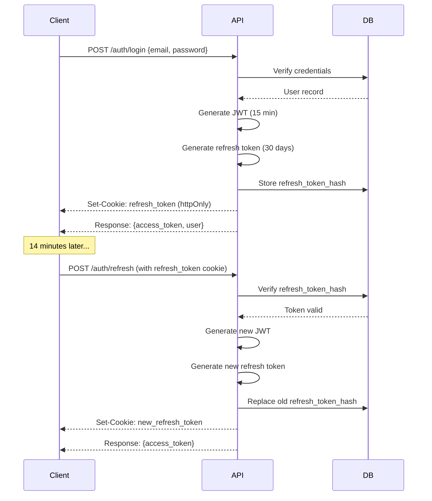

# Security & Authorization Implementation Guide
**Digital Evidence & Compliance Management Platform**

This document provides comprehensive security and authorization implementation patterns for the platform.

---

## Table of Contents

1. [Security Architecture](#security-architecture)
2. [Authentication (AuthN)](#authentication-authn)
3. [Authorization (AuthZ)](#authorization-authz)
4. [RBAC Implementation](#rbac-implementation)
5. [Object-Level Authorization](#object-level-authorization)
6. [File Security](#file-security)
7. [Audit Logging](#audit-logging)
8. [Rate Limiting & Brute Force Protection](#rate-limiting--brute-force-protection)
9. [Security Best Practices](#security-best-practices)
10. [Security Testing](#security-testing)

---

## Security Architecture

### Defense in Depth Strategy

```
┌────────────────────────────────────────────────────────┐
│ Layer 1: Network Security (TLS 1.2+, HSTS, CORS)      │
└─────────────────┬──────────────────────────────────────┘
                  ↓
┌────────────────────────────────────────────────────────┐
│ Layer 2: Authentication (JWT + Refresh Tokens)        │
└─────────────────┬──────────────────────────────────────┘
                  ↓
┌────────────────────────────────────────────────────────┐
│ Layer 3: Authorization (RBAC + Object-Level Policies) │
└─────────────────┬──────────────────────────────────────┘
                  ↓
┌────────────────────────────────────────────────────────┐
│ Layer 4: Input Validation (Schema Validation)         │
└─────────────────┬──────────────────────────────────────┘
                  ↓
┌────────────────────────────────────────────────────────┐
│ Layer 5: Business Logic Authorization                  │
└─────────────────┬──────────────────────────────────────┘
                  ↓
┌────────────────────────────────────────────────────────┐
│ Layer 6: Data Access Control (Row-Level Security)     │
└─────────────────┬──────────────────────────────────────┘
                  ↓
┌────────────────────────────────────────────────────────┐
│ Layer 7: Audit Logging (Immutable Trail)              │
└────────────────────────────────────────────────────────┘
```

---

## Authentication (AuthN)

### JWT-Based Authentication

**Token Structure:**
```json
{
  "sub": "550e8400-e29b-41d4-a716-446655440000",  // user ID
  "email": "user@example.sa",
  "roles": ["consultant"],
  "permissions": ["task:assign", "task:view_all", "evidence:review"],
  "iat": 1709740800,  // issued at
  "exp": 1709741700   // expires at (15 minutes)
}
```

**Signing Algorithm:** RS256 (asymmetric)
- Private key: signs tokens (stored securely in secrets manager)
- Public key: verifies tokens (can be distributed to services)

**Token Expiry:** 15 minutes (short-lived for security)

### Refresh Token Flow

**Refresh Token Properties:**
- 30-day expiry
- Stored as **hash** in database (`refresh_tokens` table)
- **Rotated** on every use (old token invalidated, new token issued)
- Stored in **httpOnly, Secure, SameSite=Strict** cookie

**Flow:**



### Implementation

```python
# auth_service.py

import jwt
from datetime import datetime, timedelta
from passlib.hash import bcrypt

class AuthService:
    def __init__(self, private_key, public_key, db):
        self.private_key = private_key
        self.public_key = public_key
        self.db = db
    
    async def login(self, email: str, password: str, device_info: dict, ip_address: str):
        # 1. Find user
        user = await self.db.users.find_by_email(email)
        if not user or not user.is_active:
            raise AuthenticationError("Invalid credentials")
        
        # 2. Verify password
        if not bcrypt.verify(password, user.password_hash):
            await self._record_failed_login(user.id, ip_address)
            raise AuthenticationError("Invalid credentials")
        
        # 3. Check brute force lockout
        if await self._is_locked_out(user.id):
            raise AuthenticationError("Account temporarily locked. Try again in 15 minutes.")
        
        # 4. Load permissions
        permissions = await self._load_user_permissions(user.id)
        roles = await self._load_user_roles(user.id)
        
        # 5. Generate JWT
        access_token = self._generate_jwt(user, roles, permissions)
        
        # 6. Generate refresh token
        refresh_token = self._generate_refresh_token()
        refresh_token_hash = bcrypt.hash(refresh_token)
        
        # 7. Store refresh token
        await self.db.refresh_tokens.create({
            'user_id': user.id,
            'token_hash': refresh_token_hash,
            'device_info': device_info,
            'ip_address': ip_address,
            'expires_at': datetime.utcnow() + timedelta(days=30)
        })
        
        # 8. Update last login
        await self.db.users.update(user.id, {'last_login_at': datetime.utcnow()})
        
        # 9. Audit log
        await self.audit.log(
            user=user,
            action='auth.login',
            entity_type='user',
            entity_id=user.id,
            ip_address=ip_address,
            metadata={'device': device_info}
        )
        
        return {
            'access_token': access_token,
            'refresh_token': refresh_token,  # return to be set in httpOnly cookie
            'user': user.to_dict()
        }
    
    def _generate_jwt(self, user, roles, permissions):
        payload = {
            'sub': str(user.id),
            'email': user.email,
            'roles': [r.name for r in roles],
            'permissions': [p.name for p in permissions],
            'iat': datetime.utcnow(),
            'exp': datetime.utcnow() + timedelta(minutes=15)
        }
        return jwt.encode(payload, self.private_key, algorithm='RS256')
    
    def verify_jwt(self, token: str):
        try:
            payload = jwt.decode(token, self.public_key, algorithms=['RS256'])
            return payload
        except jwt.ExpiredSignatureError:
            raise AuthenticationError("Token expired")
        except jwt.InvalidTokenError:
            raise AuthenticationError("Invalid token")
    
    async def refresh(self, refresh_token: str, device_info: dict, ip_address: str):
        # 1. Hash and find token
        token_hash = bcrypt.hash(refresh_token)
        stored_token = await self.db.refresh_tokens.find_by_hash(token_hash)
        
        if not stored_token or stored_token.revoked_at:
            raise AuthenticationError("Invalid refresh token")
        
        if stored_token.expires_at < datetime.utcnow():
            raise AuthenticationError("Refresh token expired")
        
        # 2. Revoke old token
        await self.db.refresh_tokens.update(stored_token.id, {'revoked_at': datetime.utcnow()})
        
        # 3. Load user
        user = await self.db.users.find_by_id(stored_token.user_id)
        if not user or not user.is_active:
            raise AuthenticationError("User not found or inactive")
        
        # 4. Load permissions
        permissions = await self._load_user_permissions(user.id)
        roles = await self._load_user_roles(user.id)
        
        # 5. Generate new tokens
        new_access_token = self._generate_jwt(user, roles, permissions)
        new_refresh_token = self._generate_refresh_token()
        new_refresh_token_hash = bcrypt.hash(new_refresh_token)
        
        # 6. Store new refresh token
        await self.db.refresh_tokens.create({
            'user_id': user.id,
            'token_hash': new_refresh_token_hash,
            'device_info': device_info,
            'ip_address': ip_address,
            'expires_at': datetime.utcnow() + timedelta(days=30)
        })
        
        return {
            'access_token': new_access_token,
            'refresh_token': new_refresh_token
        }
```

---

## Authorization (AuthZ)

### Two-Level Authorization Model

**Level 1: Permission-Based (Role-Based Access Control)**
- Checks if user **role** has a specific **permission**
- Example: Does this user have `evidence:review` permission?

**Level 2: Object-Level (Policy-Based)**
- Checks if user can perform action on **specific entity**
- Example: Can this user approve **this specific submission**?

### Authorization Flow

```python
async def approve_submission(request, submission_id):
    # 1. Authenticate
    user = await auth.authenticate(request)  # extracts JWT, verifies, returns user
    
    # 2. Level 1: Permission check
    if not user.has_permission('evidence:review'):
        raise ForbiddenError("You do not have permission to review evidence")
    
    # 3. Fetch entity
    submission = await submissions_repo.find_by_id(submission_id)
    if not submission:
        raise NotFoundError()
    
    # 4. Level 2: Object-level check
    policy = EvidenceSubmissionPolicy()
    if not policy.can_review(user, submission):
        raise ForbiddenError("You are not authorized to review this submission")
    
    # 5. Business logic
    # ... proceed with approval
```

---

## RBAC Implementation

### Role Hierarchy

```
Admin (Full System Control)
  ├── User Management
  ├── Settings Management
  ├── All Permissions
  │
Dean (Governance & Reporting)
  ├── Standard Management
  ├── Evidence Requirement Management
  ├── Report Generation
  ├── View All Dashboards
  │
Vice Dean (Senior Reviewer)
  ├── Task Assignment
  ├── Evidence Review
  ├── Dashboard Access
  │
Consultant (Reviewer & Supervisor)
  ├── Task Assignment
  ├── Evidence Review
  ├── View Assigned Work
  │
Employee (Evidence Submitter)
  ├── View Own Tasks
  ├── Submit Evidence
```

### Permission Matrix

See seeded permissions in [db/migrations/0002_seed_rbac.sql](../db/migrations/0002_seed_rbac.sql).

| Permission | Module | Action | Admin | Dean | Consultant | Vice Dean | Employee |
|------------|--------|--------|-------|------|------------|-----------|----------|
| `perspective:manage` | hierarchy | manage | ✓ | View | View | View | View |
| `standard:manage` | hierarchy | manage | ✓ | ✓ | View | View | View |
| `evidence_requirement:manage` | evidence_requirement | manage | ✓ | ✓ | View | View | View |
| `task:assign` | task | assign | ✓ | ✓ | ✓ | ✓ | — |
| `task:view_all` | task | view_all | ✓ | ✓ | ✓ | ✓ | — |
| `task:view_own` | task | view_own | ✓ | — | — | — | ✓ |
| `evidence:submit` | evidence | submit | ✓ | — | — | — | ✓ |
| `evidence:review` | evidence | review | ✓ | ✓ | ✓ | ✓ | — |
| `evidence_vault:read` | evidence_vault | read | ✓ | ✓ | ✓ | ✓ | — |
| `dashboard:read_global` | dashboard | read_global | ✓ | ✓ | Partial | Partial | — |
| `report:generate` | report | generate | ✓ | ✓ | — | — | — |
| `settings:manage` | settings | manage | ✓ | — | — | — | — |
| `user:manage` | user | manage | ✓ | — | — | — | — |
| `audit:read` | audit | read | ✓ | ✓ | ✓ | ✓ | — |

### Checking Permissions

```python
# User model
class User:
    def has_permission(self, permission_name: str) -> bool:
        return permission_name in self.permissions
    
    def has_any_permission(self, permission_names: list[str]) -> bool:
        return any(p in self.permissions for p in permission_names)
    
    def has_all_permissions(self, permission_names: list[str]) -> bool:
        return all(p in self.permissions for p in permission_names)
    
    def has_role(self, role_name: str | list[str]) -> bool:
        if isinstance(role_name, list):
            return any(r in self.roles for r in role_name)
        return role_name in self.roles
    
    def is_admin(self) -> bool:
        return 'admin' in self.roles

# Auth middleware
async def require_permission(user, permission: str):
    if not user.has_permission(permission):
        raise ForbiddenError(f"Permission required: {permission}")

async def require_any_permission(user, permissions: list[str]):
    if not user.has_any_permission(permissions):
        raise ForbiddenError(f"One of these permissions required: {', '.join(permissions)}")
```

---

## Object-Level Authorization

### Policy Pattern

Each entity type has a **Policy class** that defines authorization rules.

```python
# policies/standard_policy.py

class StandardPolicy:
    def can_view(self, user: User, standard: Standard) -> bool:
        """Can user view this standard?"""
        
        # Admins and Deans can view all
        if user.has_role(['admin', 'dean']):
            return True
        
        # Vice Deans can view all
        if user.has_role('vice_dean'):
            return True
        
        # Consultants can view if they own or review it
        if user.has_role('consultant'):
            if standard.owner_id == user.id or standard.reviewer_id == user.id:
                return True
        
        # Employees can view if they have a task assigned for this standard
        if user.has_role('employee'):
            return self._has_assigned_task(user.id, standard.id)
        
        return False
    
    def can_update(self, user: User, standard: Standard) -> bool:
        """Can user update this standard?"""
        return user.has_role(['admin', 'dean'])
    
    def can_delete(self, user: User, standard: Standard) -> bool:
        """Can user delete this standard?"""
        return user.is_admin()
    
    def _has_assigned_task(self, user_id: UUID, standard_id: UUID) -> bool:
        # Check if user has any tasks for this standard
        return Task.query().filter(
            Task.standard_id == standard_id,
            Task.assigned_to == user_id,
            Task.deleted_at.is_(None)
        ).exists()


# policies/evidence_submission_policy.py

class EvidenceSubmissionPolicy:
    def can_view(self, user: User, submission: EvidenceSubmission) -> bool:
        """Can user view this submission?"""
        
        # Admins, Deans, Vice Deans can view all
        if user.has_role(['admin', 'dean', 'vice_dean']):
            return True
        
        # Consultants can view if reviewing
        if user.has_role('consultant'):
            task = submission.task
            standard = task.standard
            return standard.reviewer_id == user.id or standard.owner_id == user.id
        
        # Employee can view own submissions
        if user.has_role('employee'):
            return submission.submitted_by == user.id
        
        return False
    
    def can_review(self, user: User, submission: EvidenceSubmission) -> bool:
        """Can user approve/reject this submission?"""
        
        # Must have review permission
        if not user.has_permission('evidence:review'):
            return False
        
        # Admins and Deans can review all
        if user.has_role(['admin', 'dean']):
            return True
        
        # Vice Deans can review all
        if user.has_role('vice_dean'):
            return True
        
        # Consultants can review if assigned as reviewer or owner
        if user.has_role('consultant'):
            task = submission.task
            standard = task.standard
            return standard.reviewer_id == user.id or standard.owner_id == user.id
        
        return False
```

### Policy Registry

```python
# policies/__init__.py

class PolicyRegistry:
    _policies = {
        'standard': StandardPolicy(),
        'evidence_submission': EvidenceSubmissionPolicy(),
        'task': TaskPolicy(),
        'perspective': PerspectivePolicy(),
        'axis': AxisPolicy(),
        'evidence_requirement': EvidenceRequirementPolicy()
    }
    
    @classmethod
    def get_policy(cls, entity_type: str):
        if entity_type not in cls._policies:
            raise ValueError(f"No policy defined for entity type: {entity_type}")
        return cls._policies[entity_type]
    
    @classmethod
    def authorize(cls, user: User, action: str, entity):
        """Generic authorization check"""
        entity_type = entity.__class__.__name__.lower()
        policy = cls.get_policy(entity_type)
        
        method_name = f"can_{action}"
        if not hasattr(policy, method_name):
            raise ValueError(f"Policy for {entity_type} has no method {method_name}")
        
        method = getattr(policy, method_name)
        if not method(user, entity):
            raise ForbiddenError(f"You are not authorized to {action} this {entity_type}")


# Usage in controller
await PolicyRegistry.authorize(user, 'view', standard)
await PolicyRegistry.authorize(user, 'review', submission)
```

---

## File Security

### File Upload Security

```python
ALLOWED_MIME_TYPES = [
    'application/pdf',
    'application/msword',
    'application/vnd.openxmlformats-officedocument.wordprocessingml.document',
    'application/vnd.ms-excel',
    'application/vnd.openxmlformats-officedocument.spreadsheetml.sheet',
    'image/png',
    'image/jpeg',
    'image/jpg'
]

MAX_FILE_SIZE_MB = 25

async def validate_uploaded_file(file, evidence_requirement):
    # 1. Check MIME type (not just extension)
    if file.content_type not in ALLOWED_MIME_TYPES:
        raise ValidationError(f"File type {file.content_type} not allowed")
    
    # 2. Check extension matches MIME type
    ext = file.filename.split('.')[-1].lower()
    if evidence_requirement.allowed_file_types:
        if ext not in evidence_requirement.allowed_file_types:
            raise ValidationError(f"File extension .{ext} not allowed for this requirement")
    
    # 3. Check file size
    max_size = evidence_requirement.max_file_size_mb * 1024 * 1024  # convert to bytes
    if file.size > max_size:
        raise ValidationError(f"File size exceeds maximum of {evidence_requirement.max_file_size_mb}MB")
    
    # 4. Sanitize filename
    safe_filename = secure_filename(file.filename)
    
    return safe_filename
```

### Virus Scanning

```python
# Async job handler
@job_handler('virus-scan')
async def handle_virus_scan(payload):
    file_id = UUID(payload['file_id'])
    storage_path = payload['storage_path']
    
    try:
        # Download file from object storage
        file_bytes = await storage.download('evidence', storage_path)
        
        # Scan with ClamAV
        result = await clamav_client.scan(file_bytes)
        
        if result.is_infected:
            # Mark as infected
            await evidence_files_repo.update(file_id, {
                'virus_scan_status': 'infected',
                'virus_scanned_at': datetime.utcnow()
            })
            
            # Notify admin
            await notification_service.notify_admins(
                type='security.virus_detected',
                title='Virus detected in uploaded file',
                data={'file_id': str(file_id), 'malware': result.malware_name}
            )
            
            logger.warning(f"Virus detected in file {file_id}: {result.malware_name}")
        
        else:
            # Mark as clean
            await evidence_files_repo.update(file_id, {
                'virus_scan_status': 'clean',
                'virus_scanned_at': datetime.utcnow()
            })
            
            logger.info(f"File {file_id} scanned successfully — clean")
    
    except Exception as e:
        # Mark as error
        await evidence_files_repo.update(file_id, {
            'virus_scan_status': 'error',
            'virus_scanned_at': datetime.utcnow()
        })
        
        logger.error(f"Virus scan failed for file {file_id}: {e}")
        raise
```

### Signed URL Generation

```python
async def generate_download_url(user: User, file_id: UUID) -> str:
    """Generate time-limited signed URL for file download"""
    
    # 1. Find file
    file = await evidence_files_repo.find_by_id(file_id)
    if not file:
        raise NotFoundError("File not found")
    
    # 2. Authorize
    submission = await submissions_repo.find_by_id(file.submission_id)
    policy = EvidenceSubmissionPolicy()
    if not policy.can_view(user, submission):
        raise ForbiddenError("You are not authorized to download this file")
    
    # 3. Check virus scan status
    if file.virus_scan_status == 'infected':
        raise ForbiddenError("File is infected and cannot be downloaded")
    
    if file.virus_scan_status == 'pending':
        raise ValidationError("File is still being scanned. Please try again in a moment.")
    
    # 4. Generate signed URL (15-minute expiry)
    signed_url = await storage_service.generate_signed_url(
        bucket=file.bucket,
        path=file.storage_path,
        expires_in_seconds=900,  # 15 minutes
        response_content_disposition=f'attachment; filename="{file.original_filename}"'
    )
    
    # 5. Audit log
    await audit_service.log(
        user=user,
        action='evidence_file.download_url_generated',
        entity_type='evidence_file',
        entity_id=file_id
    )
    
    return signed_url
```

---

## Audit Logging

### Immutable Audit Trail

```python
# audit_service.py

class AuditService:
    async def log(
        self,
        user: User | None,
        action: str,
        entity_type: str,
        entity_id: UUID,
        before_value: dict | None = None,
        after_value: dict | None = None,
        ip_address: str | None = None,
        user_agent: str | None = None,
        metadata: dict | None = None
    ):
        """Log an audit event"""
        
        await self.db.audit_logs.insert({
            'user_id': user.id if user else None,
            'action': action,
            'entity_type': entity_type,
            'entity_id': entity_id,
            'before_value': before_value,
            'after_value': after_value,
            'ip_address': ip_address,
            'user_agent': user_agent,
            'metadata': metadata,
            'created_at': datetime.utcnow()
        })
    
    async def query_audit_trail(
        self,
        entity_type: str | None = None,
        entity_id: UUID | None = None,
        user_id: UUID | None = None,
        action_pattern: str | None = None,
        from_date: datetime | None = None,
        to_date: datetime | None = None,
        limit: int = 100
    ) -> list:
        """Query audit logs with filters"""
        
        query = self.db.audit_logs.query()
        
        if entity_type:
            query = query.filter(AuditLog.entity_type == entity_type)
        
        if entity_id:
            query = query.filter(AuditLog.entity_id == entity_id)
        
        if user_id:
            query = query.filter(AuditLog.user_id == user_id)
        
        if action_pattern:
            query = query.filter(AuditLog.action.like(f'%{action_pattern}%'))
        
        if from_date:
            query = query.filter(AuditLog.created_at >= from_date)
        
        if to_date:
            query = query.filter(AuditLog.created_at <= to_date)
        
        return await query.order_by(AuditLog.created_at.desc()).limit(limit).all()
```

### Auto-Audit Triggers

Database triggers prevent mutation of audit logs:

```sql
-- See db/migrations/0001_init.sql
CREATE TRIGGER trg_no_audit_update
BEFORE UPDATE OR DELETE ON audit_logs
FOR EACH ROW EXECUTE FUNCTION prevent_audit_log_mutation();
```

---

## Rate Limiting & Brute Force Protection

### Redis-Based Rate Limiting

```python
# rate_limiter.py

class RateLimiter:
    def __init__(self, redis_client):
        self.redis = redis_client
    
    async def check_rate_limit(
        self,
        key: str,
        max_requests: int,
        window_seconds: int
    ) -> bool:
        """Check if rate limit exceeded using sliding window"""
        
        now = datetime.utcnow().timestamp()
        window_start = now - window_seconds
        
        # Remove old entries
        await self.redis.zremrangebyscore(key, 0, window_start)
        
        # Count requests in window
        count = await self.redis.zcard(key)
        
        if count >= max_requests:
            return False  # rate limit exceeded
        
        # Add current request
        await self.redis.zadd(key, {str(uuid4()): now})
        await self.redis.expire(key, window_seconds)
        
        return True  # allowed

# Middleware
@app.middleware('http')
async def rate_limit_middleware(request, call_next):
    user = getattr(request.state, 'user', None)
    
    # Rate limit key: per-user if authenticated, per-IP if not
    if user:
        key = f"rate_limit:user:{user.id}"
        max_requests = 100
    else:
        key = f"rate_limit:ip:{request.client.host}"
        max_requests = 20
    
    window_seconds = 60  # 1 minute
    
    allowed = await rate_limiter.check_rate_limit(key, max_requests, window_seconds)
    
    if not allowed:
        return JSONResponse(
            {'error': 'Rate limit exceeded. Please try again later.'},
            status_code=429
        )
    
    response = await call_next(request)
    return response
```

### Brute Force Protection

```python
# auth_service.py

async def _record_failed_login(self, user_id: UUID, ip_address: str):
    """Record failed login attempt"""
    key = f"failed_login:{user_id}"
    await self.redis.incr(key)
    await self.redis.expire(key, 900)  # 15 minutes

async def _is_locked_out(self, user_id: UUID) -> bool:
    """Check if user is locked out due to failed attempts"""
    key = f"failed_login:{user_id}"
    count = await self.redis.get(key)
    return int(count or 0) >= 5

async def _clear_failed_logins(self, user_id: UUID):
    """Clear failed login counter on successful login"""
    key = f"failed_login:{user_id}"
    await self.redis.delete(key)
```

---

## Security Best Practices

### Checklist for Every Endpoint

- [ ] ✅ Authenticate user (verify JWT)
- [ ] ✅ Check permission (RBAC)
- [ ] ✅ Authorize object access (policy check)
- [ ] ✅ Validate all inputs (schema validation)
- [ ] ✅ Sanitize user-provided strings (SQL injection, XSS)
- [ ] ✅ Use parameterized queries (ORM/prepared statements)
- [ ] ✅ Audit log all mutations
- [ ] ✅ Use HTTPS/TLS for all communication
- [ ] ✅ Never log sensitive data (passwords, tokens)
- [ ] ✅ Return generic error messages (don't leak implementation details)
- [ ] ✅ Apply rate limiting
- [ ] ✅ Set security headers (HSTS, CSP, X-Frame-Options)

### OWASP Top 10 Mitigations

| Vulnerability | Mitigation |
|---------------|------------|
| **A01: Broken Access Control** | Object-level authorization policies; audit all access |
| **A02: Cryptographic Failures** | TLS 1.2+; bcrypt for passwords; RS256 for JWTs |
| **A03: Injection** | Parameterized queries; input validation; ORM |
| **A04: Insecure Design** | Threat modeling; defense in depth; audit logging |
| **A05: Security Misconfiguration** | Secure defaults; principle of least privilege |
| **A06: Vulnerable Components** | Dependency scanning; keep dependencies updated |
| **A07: Authentication Failures** | Strong password policy; MFA (future); brute force protection |
| **A08: Integrity Failures** | File checksums; signed URLs; virus scanning |
| **A09: Logging Failures** | Immutable audit logs; centralized logging; monitoring |
| **A10: SSRF** | Validate URLs; allowlist external services |

---

## Security Testing

### Automated Security Tests

```python
# tests/security/test_authorization.py

def test_employee_cannot_view_others_submissions():
    employee1 = create_user(role='employee')
    employee2 = create_user(role='employee')
    
    submission = create_submission(submitted_by=employee2.id)
    
    client = authenticated_client(employee1)
    response = client.get(f'/api/v1/evidence-submissions/{submission.id}')
    
    assert response.status_code == 403
    assert 'not authorized' in response.json()['error']['detail'].lower()

def test_consultant_can_only_review_assigned_standards():
    consultant = create_user(role='consultant')
    
    # Standard owned by consultant
    standard1 = create_standard(owner_id=consultant.id)
    submission1 = create_submission_for_standard(standard1.id)
    
    # Standard NOT owned by consultant
    standard2 = create_standard()
    submission2 = create_submission_for_standard(standard2.id)
    
    client = authenticated_client(consultant)
    
    # Should succeed
    response1 = client.post(f'/api/v1/reviews', json={
        'submission_id': str(submission1.id),
        'decision': 'approved'
    })
    assert response1.status_code == 201
    
    # Should fail
    response2 = client.post(f'/api/v1/reviews', json={
        'submission_id': str(submission2.id),
        'decision': 'approved'
    })
    assert response2.status_code == 403

def test_expired_jwt_rejected():
    user = create_user()
    expired_token = generate_expired_jwt(user)
    
    client = TestClient(app)
    client.headers['Authorization'] = f'Bearer {expired_token}'
    
    response = client.get('/api/v1/auth/me')
    assert response.status_code == 401
    assert 'expired' in response.json()['error']['detail'].lower()
```

### Manual Security Testing

**Test SQL Injection:**
```bash
curl -X POST http://localhost:8000/api/v1/users \
  -H "Authorization: Bearer $TOKEN" \
  -H "Content-Type: application/json" \
  -d '{"email": "admin@ex.sa OR 1=1--", "password": "test"}'

# Should return 422 validation error, not 500
```

**Test Authorization Bypass:**
```bash
# Try to access admin endpoint as employee
curl -X GET http://localhost:8000/api/v1/settings \
  -H "Authorization: Bearer $EMPLOYEE_TOKEN"

# Should return 403 Forbidden
```

**Test File Upload Restrictions:**
```bash
# Try to upload .exe file
curl -X POST http://localhost:8000/api/v1/evidence-submissions \
  -H "Authorization: Bearer $TOKEN" \
  -F "files=@malware.exe"

# Should return 422 validation error
```

---

## Summary

| Aspect | Implementation |
|--------|----------------|
| **Authentication** | JWT (RS256, 15-min) + Refresh Tokens (30-day, rotated) |
| **Authorization** | RBAC (permission-based) + Object-Level (policy-based) |
| **File Security** | Private storage, signed URLs, virus scanning, type validation |
| **Audit Logging** | Immutable logs, before/after values, full traceability |
| **Rate Limiting** | Redis sliding window, per-user + per-IP |
| **Brute Force Protection** | 5 failed attempts → 15-min lockout |
| **Encryption** | TLS 1.2+, bcrypt passwords, RS256 JWTs |

---

## Additional Resources

- [ARCHITECTURE.md](../ARCHITECTURE.md) — Full architecture specification
- [API_IMPLEMENTATION_GUIDE.md](API_IMPLEMENTATION_GUIDE.md) — API implementation patterns
- [db/migrations/0002_seed_rbac.sql](../db/migrations/0002_seed_rbac.sql) — RBAC seed data

--- *Last Updated: March 6, 2026*
