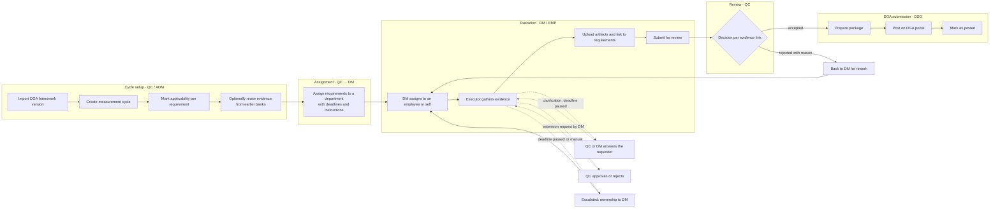
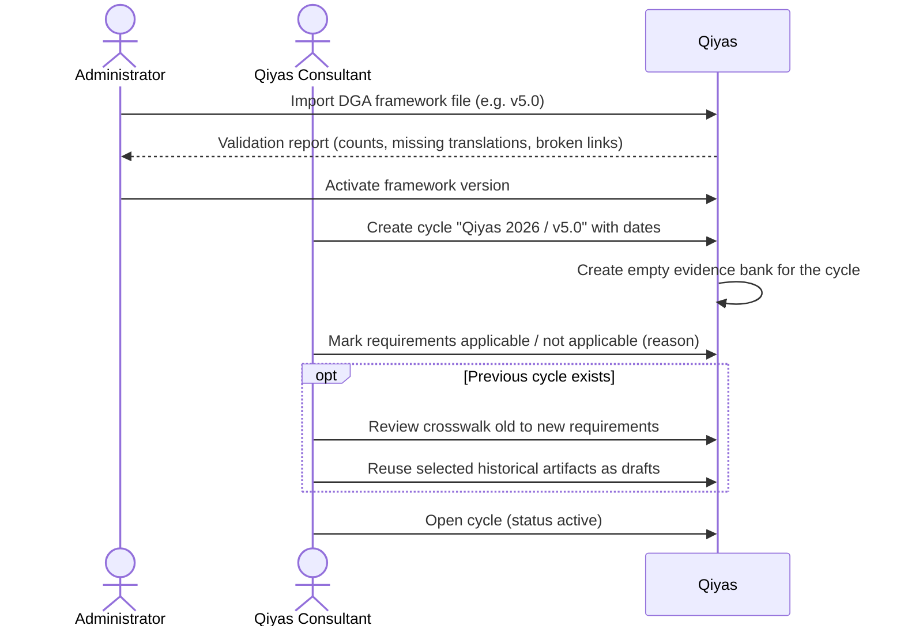
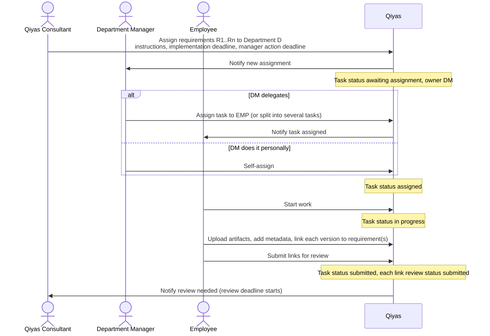
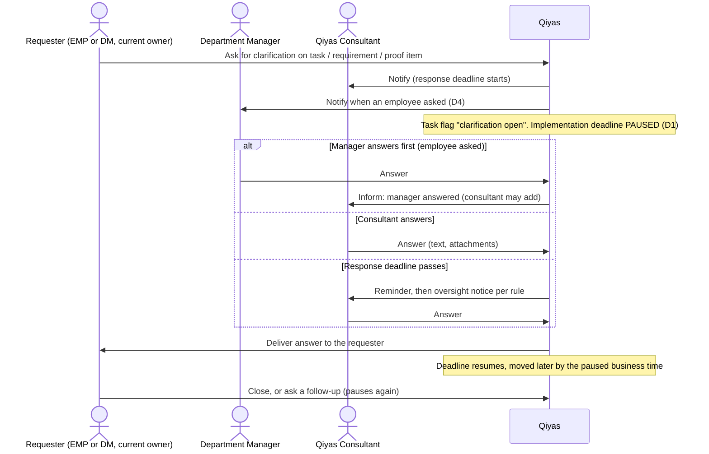
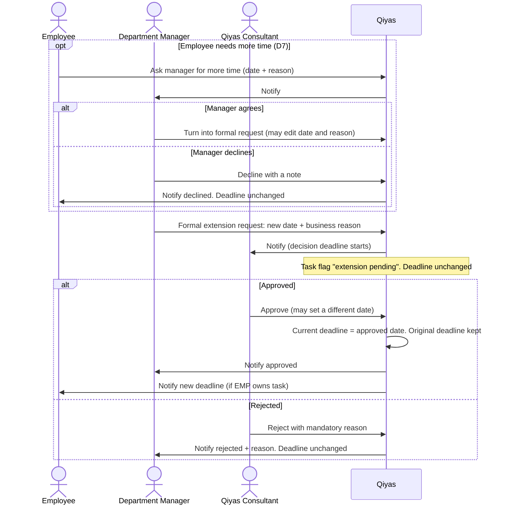
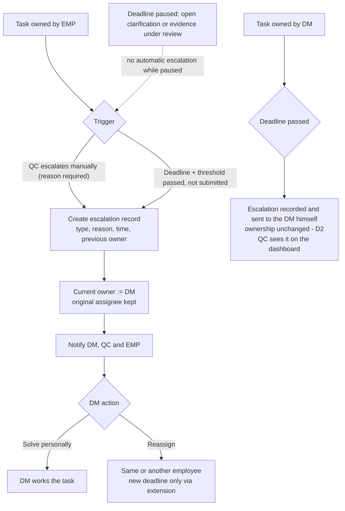
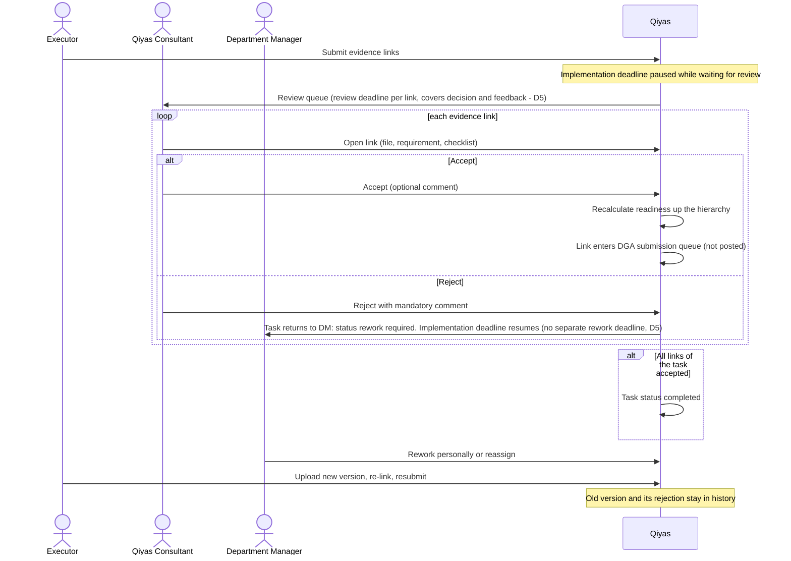
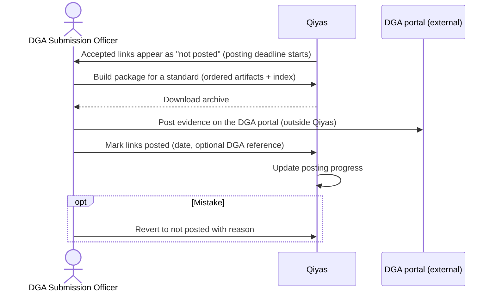
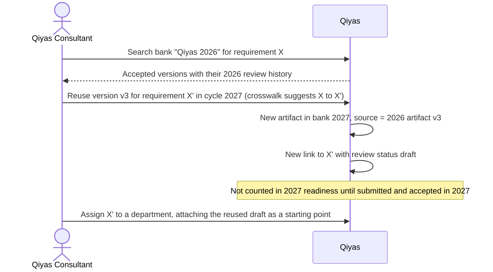

# 03 · End-to-End Workflows — Phase 1

[← Index](README.md)

Roles: **QC** Qiyas Consultant · **DM** Department Manager · **EMP** Employee · **DSO** DGA Submission Officer · **SYS** the system (scheduler, rules).

## W0 · The whole journey

## W1 · Cycle setup

## W2 · Assignment and execution

## W3 · Clarification

## W4 · Extension request

## W5 · Escalation

## W6 · Review and rework

## W7 · DGA submission

## W8 · Reuse from a historical bank

