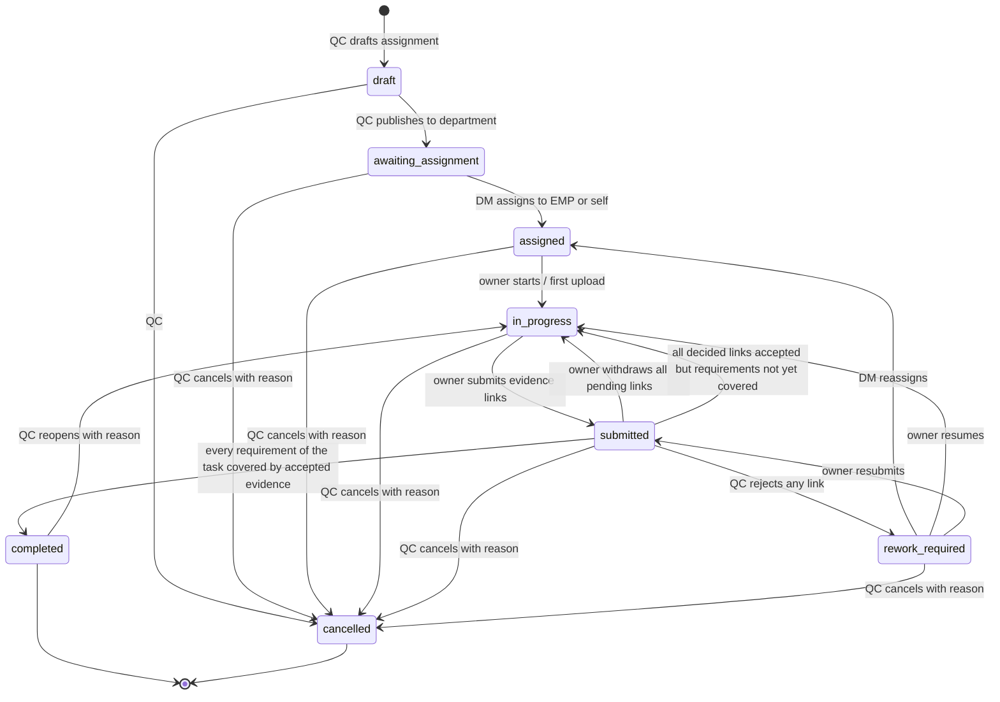
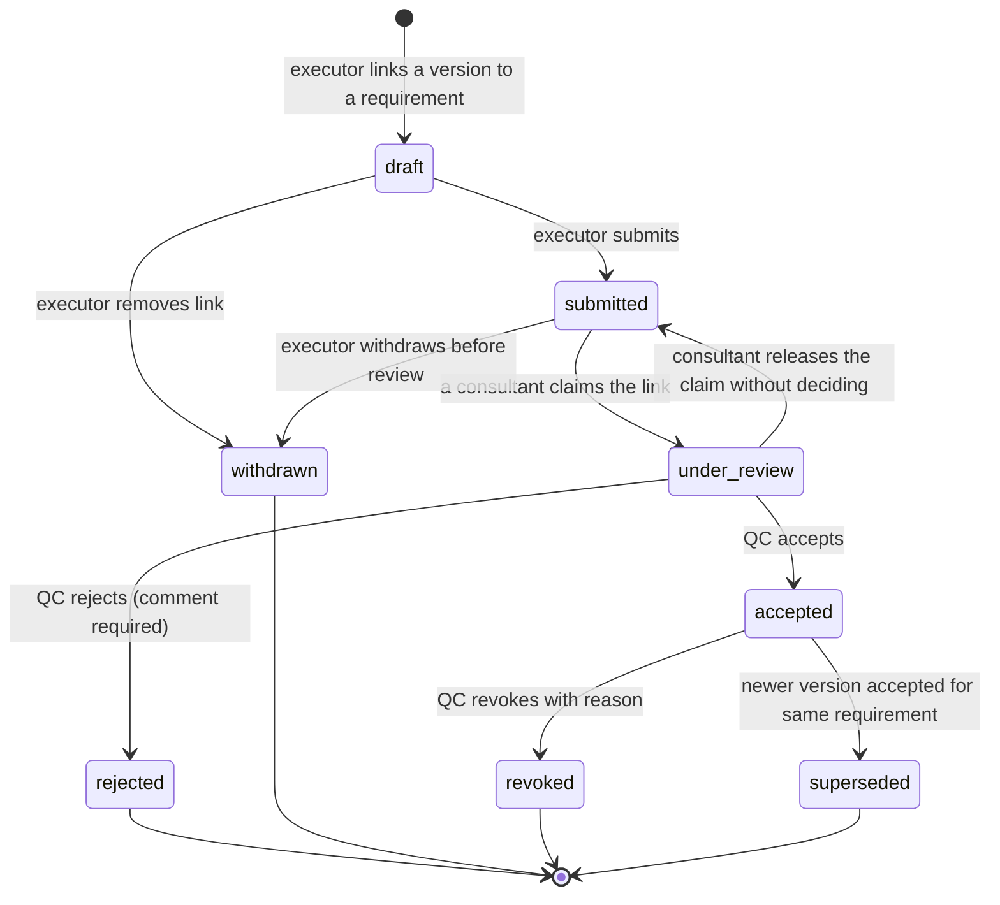
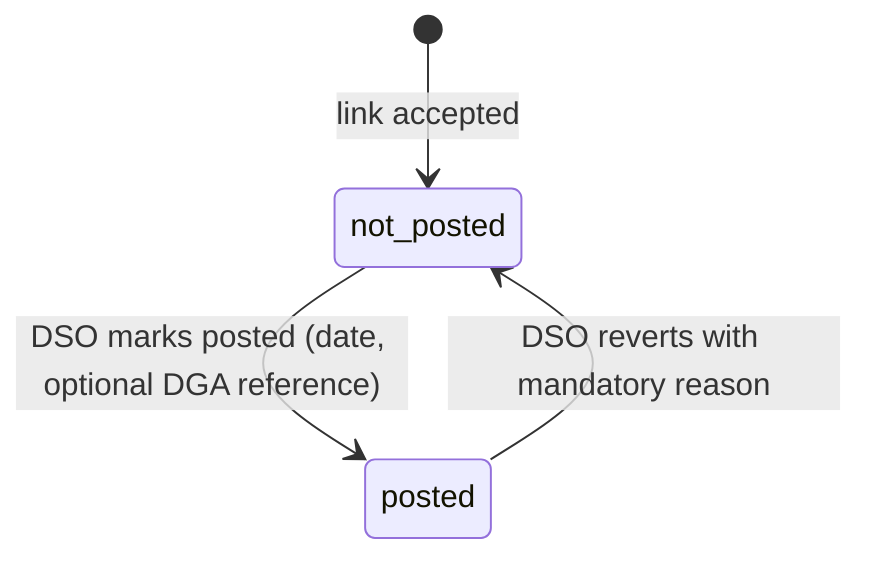
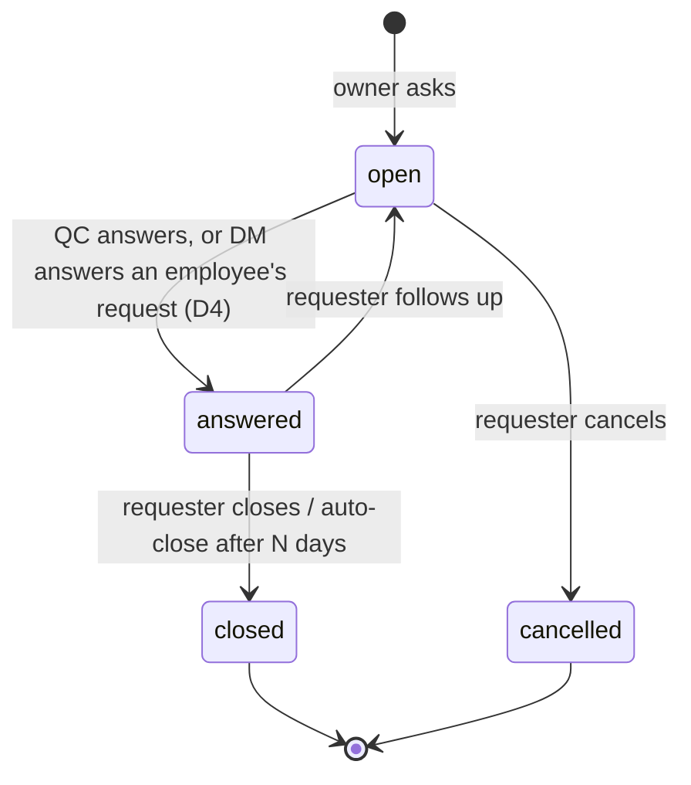
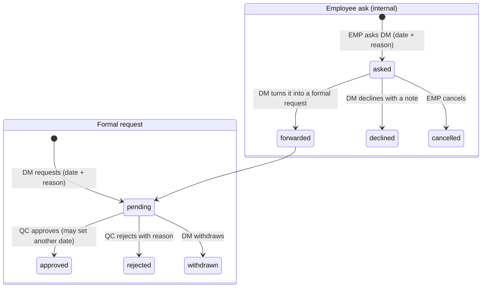
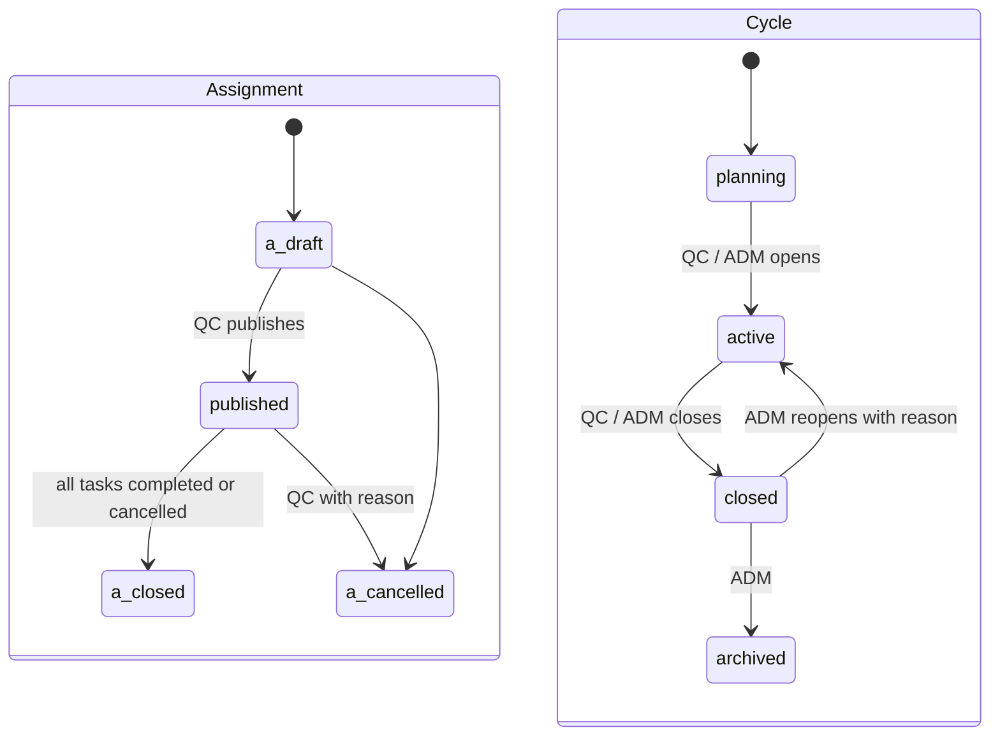
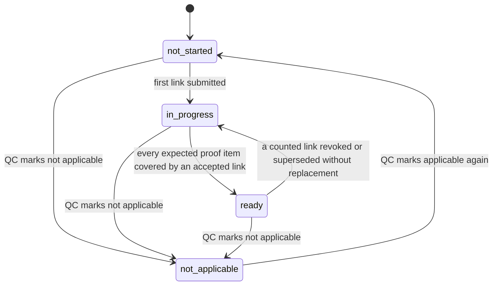

# 04 · Workflow State Machines — Phase 1

[← Index](README.md)

Three statuses are kept **independent** (decision 8):

| Machine | Entity | Section |
|---|---|---|
| Task execution status | `task` | [§1](#1-task-execution-status) |
| Evidence review status | `evidence_link` | [§2](#2-evidence-review-status) |
| Evidence submission status | `evidence_link` | [§3](#3-evidence-submission-status-dga-posting) |

Supporting machines: clarification, extension, assignment, cycle. Requirement readiness is **derived**, never set by hand.

Every transition writes an audit record (actor, time, from, to, reason). Transitions not listed are rejected by the server.

---

## 1. Task execution status

| From → To | Who | Conditions / effects |
|---|---|---|
| draft → awaiting_assignment | QC | Department, requirements, deadlines set. Owner = department manager. Manager action deadline starts. |
| awaiting_assignment → assigned | DM | Assignee is a member of the department or the DM. Original assignee recorded once. |
| assigned → in_progress | Owner / system | Explicit "start", or automatically on first upload. |
| in_progress → submitted | Owner | At least one evidence link in *draft* is submitted. |
| submitted → rework_required | System | Any link of the task becomes *rejected*. Owner := DM. The implementation deadline resumes; there is no separate rework deadline (D5). |
| submitted → completed | System | All requirements on the task are *ready* (see §7). |
| completed → in_progress | QC | Reopen with mandatory reason (e.g. evidence later found invalid). |
| any open → cancelled | QC | Mandatory reason. Evidence stays in the bank. |

**Flags (not statuses):** `is_overdue` (computed from current deadline), `is_escalated` (≥ 1 escalation record), `has_open_clarification`, `has_pending_extension`, `is_deadline_paused`.

**Deadline pausing.** The implementation deadline is paused (no reminders, no overdue, no automatic escalation) while:

| Pause reason | Starts | Ends |
|---|---|---|
| Open clarification (D1) | Clarification raised or follow-up asked | Answered by the consultant or the manager |
| Evidence waiting for review (D5) | Task moves to *submitted* | Task leaves *submitted* (rework required, back to in progress, completed) |

When a pause ends, `current_due_at` moves later by the paused working time, **rounded to the nearest whole working day** (deadlines are end-of-day dates; a pause under half a working day does not move them). Every pause is recorded (start, end, reason) and `original_due_at` never changes.

**Ownership is separate from status.** Escalation (manual or automatic) changes `current_owner` to the DM and records history; it does **not** change the execution status. Fields: `original_assignee_id` (never changes after first assignment), `current_owner_id`, ownership history table.

---

## 2. Evidence review status

Applies to each **evidence link** (artifact version ↔ requirement).

| Rule | |
|---|---|
| R-1 | Reviewer ≠ uploader (SoD-1). Evidence attached by a consultant (D3) is reviewed by another consultant (D9). |
| R-2 | Rejection comment is mandatory (min. 10 characters); acceptance comment optional. |
| R-3 | A rejected link is final. Rework = upload a **new version** and create a **new link**. |
| R-4 | Only *accepted* links count towards readiness. *Revoked* and *superseded* links stop counting immediately. |
| R-5 | Review deadline runs from *submitted* and covers the decision and, for a rejection, its feedback (D5). |
| R-6 | Files with virus-scan status other than *clean* cannot move to *under_review*. |

---

## 3. Evidence submission status (DGA posting)

Applies to each evidence link, **only once it is accepted**. Answering the open question from the business: **yes — Phase 1 has two internal statuses.**

| Status | Meaning |
|---|---|
| **not_posted** — *Not posted to DGA yet* | Accepted internally, waiting for the DGA Submission Officer. Posting deadline runs. |
| **posted** — *Posted to DGA* | Officer confirms it is on the DGA portal. Stores `posted_at`, `posted_by`, optional `dga_reference`, notes. |

Rules:

- Only *accepted* links enter this machine (SoD-4).
- If a posted link is later *revoked* or *superseded*, the posting record is kept and the requirement shows **"posted evidence changed — re-post needed"** on the officer's and executives' dashboards.
- Phase 1 does **not** record what DGA did with posted evidence (no DGA result statuses).
- Requirement-level posting state is derived: *none* / *partially posted* / *fully posted* (all accepted links of an applicable requirement posted).

---

## 4. Clarification request

The consultant's response deadline runs while *open*; an answer by the manager also stops it. The answer goes to the requester; the consultant is informed when the manager answered. While *open*, the task's implementation deadline is **paused** (D1).

## 5. Extension request

Two levels (D7): an employee's ask to the manager, and the manager's formal request to the consultant.

- At most one *pending* formal request and one open employee ask per task.
- Approval updates `current_due_at`; `original_due_at` never changes.
- Rejection leaves the deadline unchanged; the reason is shown to the DM (and to the employee when the request came from his ask).

## 6. Assignment and cycle

- **Closed cycle:** no new uploads, links or decisions; bank becomes read-only and searchable.
- **Archived cycle:** hidden from default views; still searchable for reuse and audit.

## 7. Derived readiness (never set by hand)

Calculations (BR-CMP):

| Level | Readiness % |
|---|---|
| Expected proof item | covered / not covered |
| Requirement | ready if all its expected proof items are covered (or ≥ 1 accepted link when it has none) |
| Standard / axis / perspective / cycle | ready applicable requirements ÷ applicable requirements |
| Posting progress | posted accepted links ÷ accepted links |
