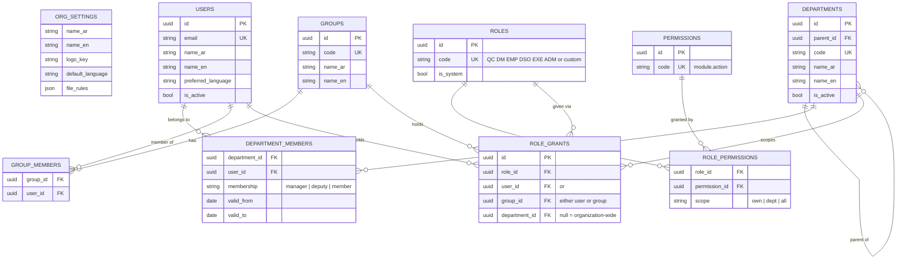
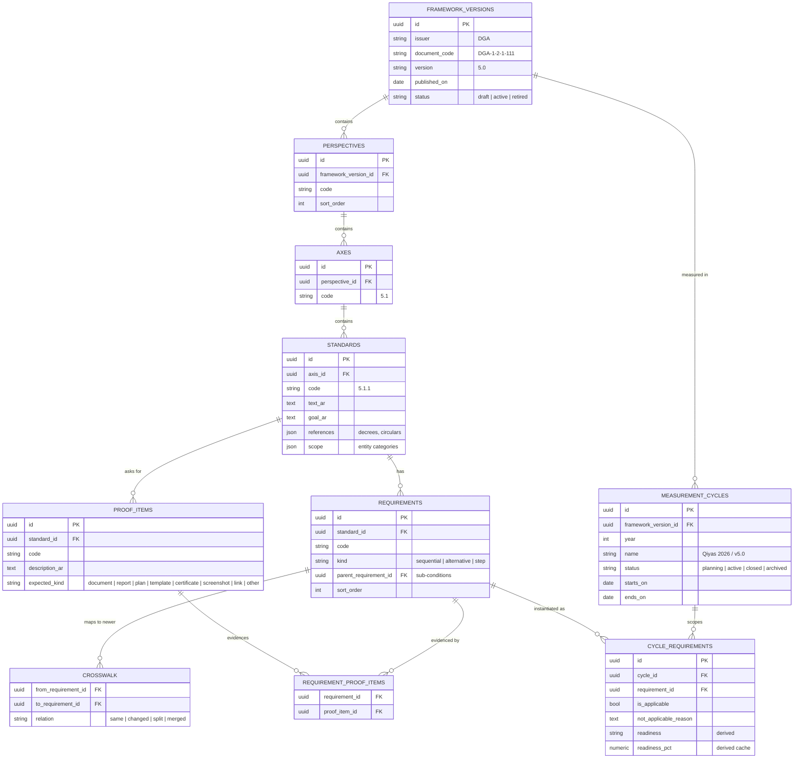
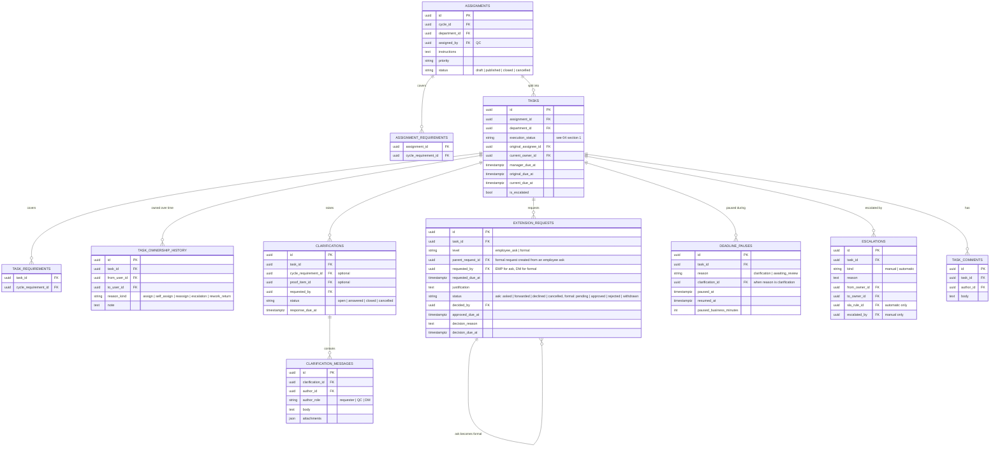
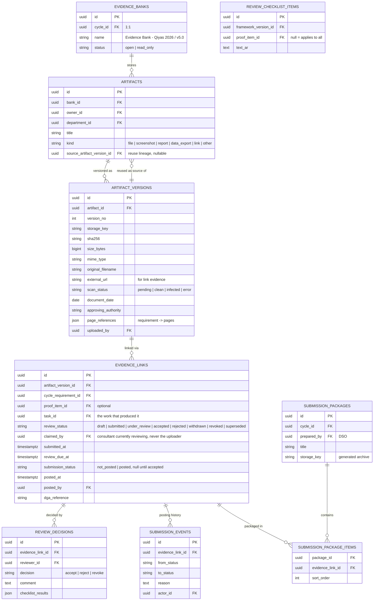
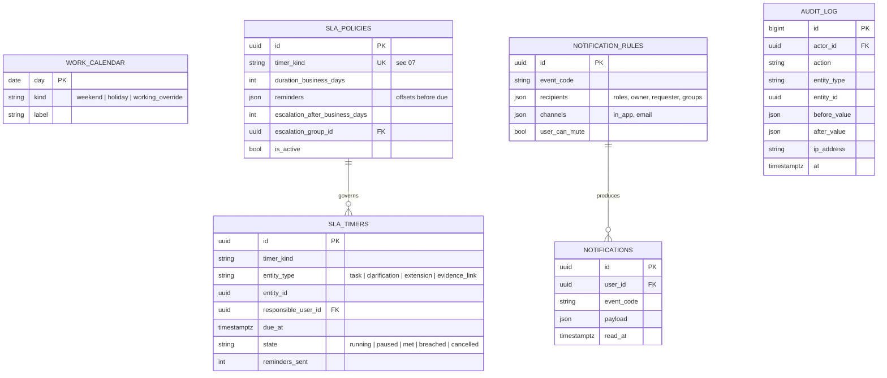

# 05 · Entity Relationship Diagram — Phase 1

[← Index](README.md)

One database per client installation (no tenant column). The model is split into five areas; keys shown are the important ones, not every column.

Conventions for every table: `id uuid`, `created_at`, `created_by`, `updated_at`, `updated_by`, soft delete `deleted_at` where records are user-facing. Bilingual text uses `*_ar` / `*_en` columns; UI-only languages (Urdu) come from the translation layer, while framework content can carry an optional `*_ur`.

## A · Organization and administration

Rule: each active department has exactly one member with `membership = manager` at any time (enforced by a partial unique index).

## B · Framework (versioned DGA content) and cycles

`CYCLE_REQUIREMENTS` is the anchor for all operational data: assignments, evidence links and readiness all point at a requirement **within a cycle**, so two cycles never share status.

## C · Work: assignments, tasks, clarifications, extensions, escalations

## D · Evidence, review and submission

`EVIDENCE_LINKS` carries **two independent status columns** (review, submission). The task's execution status lives only on `TASKS`. No table stores a combined status.

## E · Deadlines, notifications, audit

`AUDIT_LOG` is append-only: the application database user has `INSERT` and `SELECT` only.

## Key integrity rules

| Rule | Enforcement |
|---|---|
| A task covers only requirements of its own assignment | FK + check in service layer |
| Task assignee is a member of the task's department or its manager | Service layer + trigger |
| One pending formal extension and one open employee ask per task | Partial unique indexes on `(task_id, level) WHERE status IN ('pending','asked')` |
| Nobody holds both `QC` and `DSO` (D3) | Check on role grant (service layer + trigger on `ROLE_GRANTS`) |
| `current_due_at` = `original_due_at` + paused business time; with an approved extension, the approved date + paused business time after the approval (`approved_extension_at`, BR-EXT-03) | Recomputed by the deadline service; every change audited |
| One manager per department | Partial unique index on `(department_id) WHERE membership = 'manager' AND valid_to IS NULL` |
| `submission_status` only set when `review_status = 'accepted'` (or kept for history after revoke/supersede) | Check constraint + service |
| Reviewer ≠ uploader (D9) | Service layer on claim and decision + check in `REVIEW_DECISIONS` insert |
| One active claim per queue item | `claimed_by` set atomically; released on decision, release or timeout |
| Artifact in bank of a closed cycle is read-only | Service layer on `EVIDENCE_BANKS.status` |
| Evidence link's requirement belongs to the bank's cycle | FK through `cycle_requirement_id` + check |
