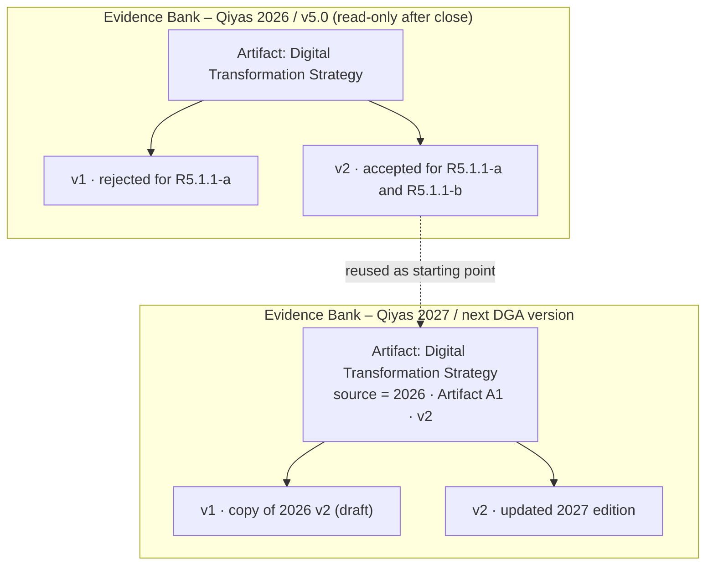
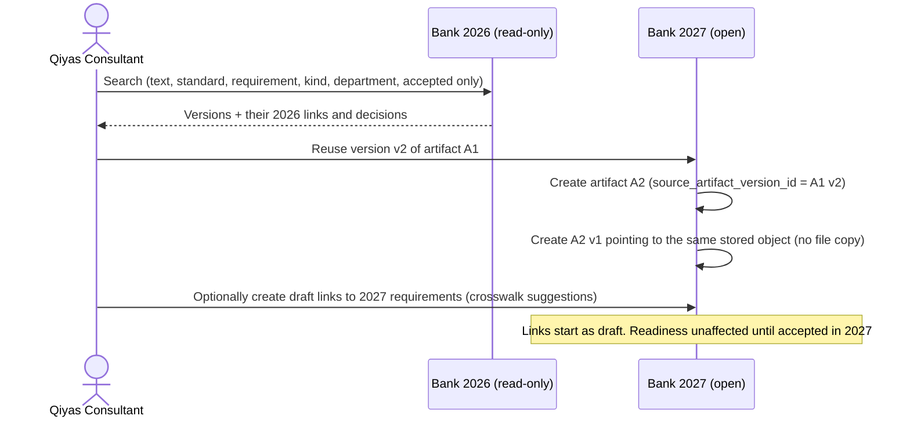

# 06 · Evidence Bank Data Model — Phase 1

[← Index](README.md)

## 1. Principles

1. **One bank per measurement cycle.** *Evidence Bank – Qiyas 2026 / v5.0*, *Evidence Bank – Qiyas 2027 / v6.x*, and so on.
2. **Evidence is an independent entity.** An artifact exists in the bank whether or not a task is still open; tasks only *produce* evidence links.
3. **Nothing is overwritten.** Corrections are new versions; decisions are new records; banks of closed cycles are read-only.
4. **Validity never carries over.** Acceptance belongs to a link inside one cycle. Reused evidence starts as draft and needs fresh review.
5. **Lineage is permanent.** Every reused artifact knows exactly which version, in which cycle, it came from.

## 2. Structure



| Level | Entity | Belongs to | Key facts |
|---|---|---|---|
| Bank | `evidence_banks` | one cycle (1:1) | status *open* while cycle active, *read_only* after close |
| Artifact | `artifacts` | one bank | owner, department, kind, title; optional `source_artifact_version_id` |
| Version | `artifact_versions` | one artifact | file or link, hash, scan status, document metadata, uploader |
| Link | `evidence_links` | one version × one cycle requirement (× optional proof item) | review status, submission status, deadlines |
| Decision | `review_decisions` | one link | reviewer, decision, comment, checklist |

## 3. Artifact kinds and metadata

| Kind | Content | Typical DGA proof |
|---|---|---|
| `file` | PDF, Word, Excel, PowerPoint, archives | policies, plans, studies, reports |
| `screenshot` | PNG, JPG | system screens, published pages |
| `report` | Generated reports (PDF/XLSX) from internal systems | KPI and performance reports |
| `data_export` | CSV, XLSX extracts | registers, inventories |
| `link` | URL (+ optional capture) | published content, social media posts |
| `other` | Anything allowed by file rules | — |

DGA-relevant metadata on each version: **document date** (must fall in the cycle for reports and studies), **approving authority** (for approved documents), **page references** per requirement (mandatory when the document exceeds the configured page threshold, default 20), **external URL** for published content. These feed the optional review checklist.

## 4. Mapping and reuse inside one cycle

- One **version** can be linked to **many requirements** (e.g. a strategy document proves several requirements of 5.1.1 and one of 5.2.3).
- One **requirement** can have **many links** (several artifacts needed).
- Each link is reviewed on its own: the same version can be accepted for one requirement and rejected for another.
- Re-linking an already accepted version to another requirement creates a new link in *draft*; it needs its own review.

## 5. Reuse across cycles



Rules:

| ID | Rule |
|---|---|
| BNK-1 | Only the consultant can reuse (`bank.reuse`). |
| BNK-2 | Reuse creates a **new artifact** in the current bank; the historical artifact is untouched. |
| BNK-3 | The first version of the new artifact references the **same stored object** as the source version (content-addressed by SHA-256); no duplicate storage. Later versions are new uploads. |
| BNK-4 | Reused evidence appears in the current cycle with a "Reused from Qiyas 2026" badge and a link to its history. |
| BNK-5 | Crosswalk relations (`same`, `changed`, `split`, `merged`) **suggest** target requirements; the consultant confirms each link. |
| BNK-6 | Reused links count toward readiness only after normal submission and acceptance in the current cycle. |
| BNK-7 | Reuse can also be handed to a department: the consultant attaches reused drafts to an assignment so the executor starts from them. |
| BNK-8 | The consultant can also attach reused or central evidence to a task himself and submit it, like a normal employee (D3). It is then reviewed by another consultant (D9). |

### 5.1 Carry-over and folder import (batch 6)

| ID | Rule |
|---|---|
| BNK-9 | **Carry-over** copies every accepted version of an earlier cycle into the current bank (same stored object) and creates a *suggestion* for each matching requirement: the same requirement when both cycles use the same framework version, otherwise the crosswalk targets. Requirements marked *removed* in the crosswalk get no suggestion. Running it again skips evidence already carried over. |
| BNK-10 | **Folder import** takes a folder organized for the DGA portal. The most specific code in the path decides: `5.3.2.7` = requirement R7 of standard 5.3.2; `5.3.2` = every requirement of the standard; an axis code alone (`5.18`) or no code = *unmatched*. Names may follow an older framework version; they are translated through the crosswalk. System and shortcut files are skipped; the same content already in the bank is not stored twice. |
| BNK-11 | Neither feature links anything. The task owner (or a consultant) **uses** or **dismisses** each suggestion on the task page; using creates a normal draft link (and starts an assigned task). The importer counts as the uploader, so another consultant reviews it (D9). |
| BNK-12 | Task owners can download a file suggested for their task before deciding. |

## 6. Search

Indexed fields: title, file name, extracted text (PDF/Office, Phase 1 best effort), standard/requirement codes, perspective/axis, kind, department, owner, document date, review status, cycle. Filters default to **accepted** evidence when searching history.

## 7. Storage layout (MinIO / S3-compatible, on-premises)

```
qiyas-evidence/
  objects/<sha256-prefix>/<sha256>        ← immutable content, shared by reuse
  quarantine/<uuid>                       ← infected uploads, never served
  packages/<cycle-id>/<package-id>.zip    ← DGA submission packages (regenerable)
```

- Object keys never contain original file names (BR-FILE).
- Downloads use signed URLs valid for 15 minutes (configurable), and every download is written to the audit log.
- Server-side encryption enabled.

## 8. Lifecycle of a bank

| Cycle status | Bank status | Allowed |
|---|---|---|
| planning | open | Reuse, draft artifacts |
| active | open | Everything |
| closed | read_only | Search, view, download (by permission), reuse into a newer cycle |
| archived | read_only | Same as closed; hidden from default lists |

## 9. Retention

- Artifacts and versions of closed cycles are retained for the client's evidence retention period (default 5 years after cycle close), then flagged for an administrator-approved purge.
- An object shared by reuse is purged only when no retained version references it.
- Audit records are retained separately (default 7 years) and never purged by evidence retention.
