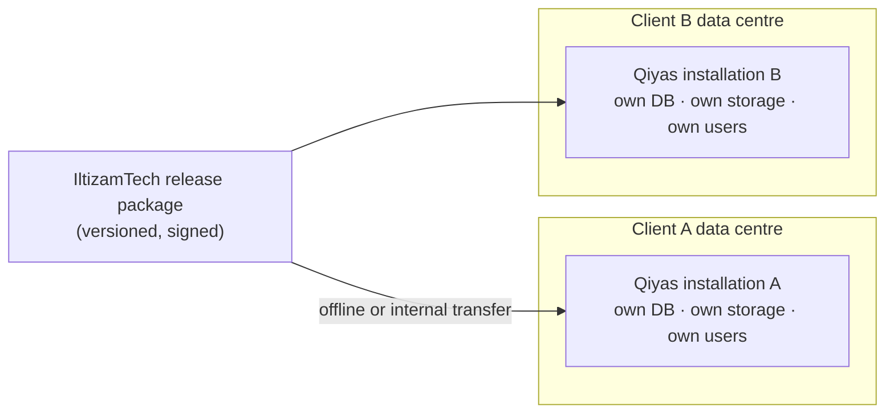
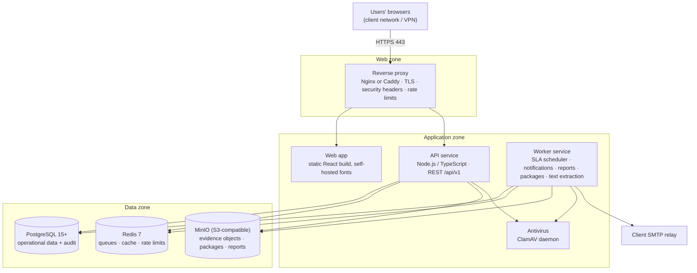

# 09 · On-Premises Deployment Architecture — Phase 1

[← Index](README.md)

## 1. Model

**One independent installation per government client** (decision 6). Each installation has its own database, file storage, users, departments, groups, cycles, evidence banks, configuration and audit records. Installations share **code releases**, never data.

## 2. Components of one installation

| Component | Role | Notes |
|---|---|---|
| Reverse proxy | TLS termination, static files, `/api` routing | Client certificate (internal CA accepted). HSTS, CSP, upload size limit. |
| Web app | React 19 single-page app | Built once per release; **fonts and assets self-hosted** (no internet calls). Client branding comes from settings via the API, not from the build. |
| API | All business logic and permission checks | Stateless; can run 2+ instances behind the proxy. |
| Worker | Timers (every ≤ 5 min), emails, reports, packages, virus-scan orchestration, text extraction for search | Runs separately from the API; idempotent jobs. |
| PostgreSQL | Single source of truth | Audit table with INSERT/SELECT-only grants for the app user. |
| Redis | Job queues (BullMQ), caching | No durable business data. |
| MinIO | Evidence and generated files | Server-side encryption, versioning on, private buckets, signed URLs only. |
| ClamAV | Scans every upload before it becomes reviewable | Signature updates from an internal mirror if no internet. |
| SMTP | Email notifications | Client's relay; optional (in-app always works). |

## 3. Sizing (starting point)

| Size | Users | Topology | vCPU / RAM | Storage |
|---|---|---|---|---|
| Small | ≤ 200 | 1 application VM (proxy, web, API, worker, AV) + 1 data VM (Postgres, Redis, MinIO) | 4 / 16 GB each | DB 100 GB, objects 500 GB |
| Medium | ≤ 1,000 | 2 application VMs (active-active) + 1 data VM + 1 storage VM | 8 / 32 GB | DB 250 GB, objects 2 TB |

Object storage grows with evidence; plan 1–2 TB per cycle for large entities and monitor at 80 %.

## 4. Packaging and operations

| Topic | Approach |
|---|---|
| Packaging | Container images (Docker / Podman with Compose) as the standard; a Windows Server variant using the existing PowerShell scripts is possible but not the primary target. |
| Offline install | Release = images + migrations + checksum manifest, transferable without internet access. |
| Configuration | Per-installation `.env` (secrets, endpoints) + in-app settings (branding, calendar, SLAs, notifications). No client data in the release. |
| First run | Setup wizard: organization profile, first administrator, SMTP, calendar, import DGA framework version. |
| Upgrades | Versioned database migrations run by a dedicated step; backup taken automatically first; documented rollback. |
| Framework updates | New DGA versions are delivered as **data files** and imported in the app; no code release needed. |
| Logging | Structured JSON logs; optional forwarding to the client SIEM. |
| Monitoring | Health endpoints for API, worker, DB, Redis, MinIO, ClamAV; disk-usage alerts. |
| Time | All servers NTP-synced; dates stored in UTC, displayed in Asia/Riyadh (configurable). |

## 5. Security

| Area | Control |
|---|---|
| Network | Users reach only the proxy; data zone not reachable from user networks. |
| Transport | TLS 1.2+ everywhere, including app ↔ DB and app ↔ MinIO where supported. |
| Authentication | Local accounts (bcrypt cost ≥ 12, lockout after 5 failures, password policy). AD/LDAP/SSO in a later phase. |
| Sessions | Short-lived access token, rotating refresh token in httpOnly cookie, CSRF protection. |
| Authorization | Server-side permission + scope check on every request (see [02](02-roles-and-permissions.md)). |
| Files | Virus scan, type allow-list, size limits, random object keys, signed URLs, every download audited. |
| Data at rest | Disk encryption on data VMs; MinIO server-side encryption. |
| Audit | Append-only, database-enforced; retention ≥ 7 years by default. |
| Administration | Admin actions audited; optional two-person rule for granting admin/operational roles. |

## 6. Backup and recovery

| Item | Policy (default) |
|---|---|
| PostgreSQL | Nightly full + continuous WAL archiving; point-in-time recovery |
| MinIO | Nightly replication/snapshot to secondary storage |
| Retention of backups | 30 days daily, 12 months monthly |
| RPO / RTO | ≤ 15 minutes / ≤ 4 hours (medium size) |
| Restore test | Quarterly, documented |

## 7. As built (batch 6e)

The release package lives in [`deploy/`](../../deploy/README.md): a Compose file for one installation, the Nginx reverse proxy (TLS, HSTS, CSP, 60 MB uploads), `.env.example`, the install / upgrade / backup guide and `make-release.sh`, which writes the offline package (images + compose + checksums).

| Topic | As built |
|---|---|
| Evidence storage | `QIYAS_STORAGE=minio`: content-addressed private objects (`objects/ab/<sha256>`), integrity-checked on every read, optional server-side encryption. MinIO stopped publishing community images in 2025; the compose file uses Chainguard's MinIO build, pinned by digest. Any S3-compatible store works. |
| Virus scanning | ClamAV over clamd `INSTREAM`. Fails closed: a timeout, a size limit or an unreachable daemon marks the file as not clean. The API refuses to start in production without ClamAV (`QIYAS_ALLOW_DEV_SCANNER=true` only for test installations). |
| Framework data | The official DGA v5.0 and v4.0 files and their crosswalk ship in the API image and load at first start (new versions only, activated). |
| First administrator | `createAdmin` command inside the API container (see the install guide); everything else is set in the app. |
| Branding | Organization name and logo (PNG/JPEG/WebP, checked by content and scanned) are settings; the sign-in page reads them before sign-in. |
| Fonts | IBM Plex Sans Arabic and Poppins are bundled with the web app; the CSP allows no external origin. |
| Health | `GET /api/v2/public/health`: database, storage, scanner; used by the container health checks. |
| Network | Data services on an internal network; only ClamAV's updater reaches its mirror. |

Not yet: a setup wizard (the admin command plus the Organization page cover it), Redis-backed job queues for reports (reports run on request), MinIO replication and WAL archiving (documented as operator tasks in the guide).

## 8. What changed from the earlier setup

- Google Fonts were loaded from the internet: now **bundled** with the web app (done).
- The Jouf University logo was built into the login page: branding now comes from **settings** (done; the logo file was removed from the code).
- Development-only pieces (`mock-api/`, debug files, `caddy.exe` and helper scripts in the repo root) are excluded from the images by `.dockerignore` and are not part of release packages (done).
- The old Windows/Caddy launch path (`Caddyfile`, `caddy.exe`, the `Start-Qiyas-*.ps1`, `Start-Frontend-Port80.ps1`, `Open-Firewall.ps1` and `Stop-IIS.ps1` scripts) was **removed from the repository**. The Docker stack in `deploy/` (see `deploy/README.md`) is the only supported way to serve Qiyas to users. The Vite dev server, `mock-api/` and `npm run dev:phase1` are for a developer's own machine only: they listen on localhost and refuse proxied or non-localhost requests.
